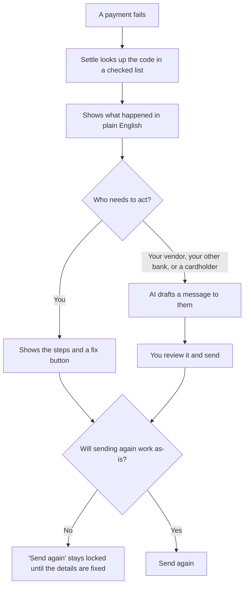
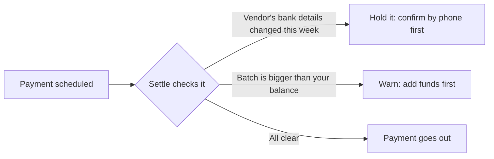
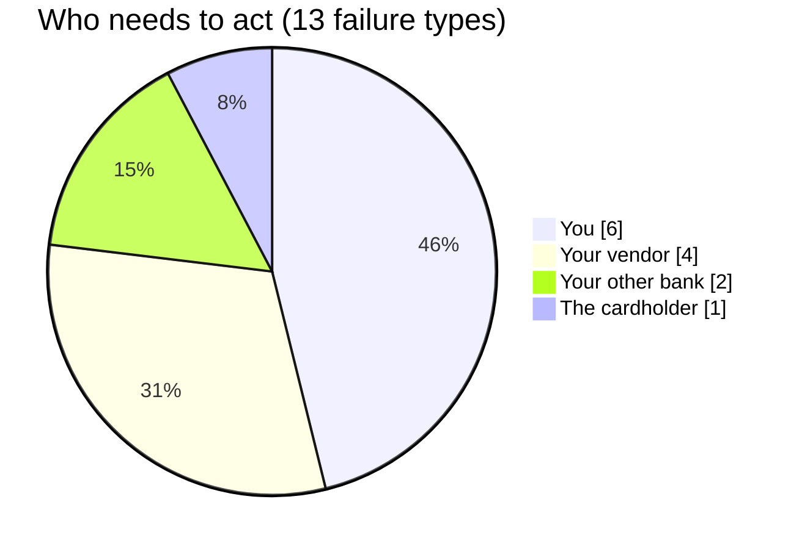
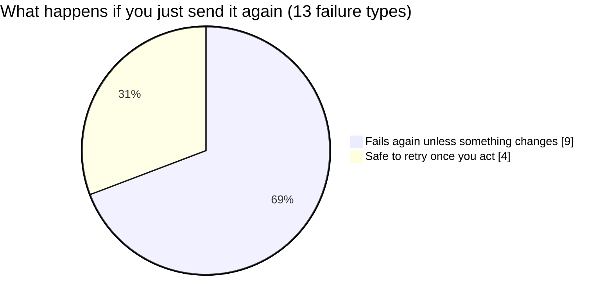
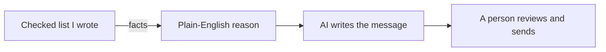

# Settle: Failed-Payment Copilot

Money moves, cards get declined, and payments either settle or fail. **Settle focuses on the moment a payment fails, when a bank transfer comes back or a card is declined, and turns it into a plain-English explanation plus a one-click fix.**

In the US, most transfers between bank accounts travel over **ACH**, the network banks use to move money between accounts. When an ACH payment fails, the bank sends back only a short **return code**, like R03. With Settle, a founder sees this instead:

> "Your $8,400 payment to Northwind Studio came back because their bank couldn't find an account with that number (ACH return code R03). Ask them to confirm their details. Here's a message ready to send."

Finance teams also get a view of which payments are at risk of failing **before** they go out.

**Live demo:** _add your Vercel link here_

---

## What happens when a payment fails

## Catching problems before money moves

A sudden change in a vendor's bank details is a common trick scammers use to redirect payments, so Settle holds those until you confirm.

## What I found

Settle covers 13 common ways a payment can fail. Grouping them showed two things that shaped the product.

**1. Most failures need someone else to fix them.**

7 of 13 failures depend on someone other than you. Explaining the problem isn't enough, so Settle also drafts the message to the person who can fix it.

**2. Most failures will happen again if you just retry.**

9 of 13 will fail again if nothing changes. So Settle locks the "send again" button until the cause is fixed, which saves days of waiting on a payment that was never going to work.

## How AI is used, and where it isn't

The reason for every failure comes from a fixed list I wrote and checked, never from AI, because a wrong explanation about someone's money is worse than none. AI only writes the message, using those facts. A person always reviews it. AI never moves money or retries a payment.

## How I'd measure success

I defined these before building:

- **Main goal:** less time between a payment failing and the customer fixing it
- **Fewer repeat failures:** payments that fail again after being retried
- **Fewer support tickets** about failed payments
- **Safety check:** fraud warnings must stay rare and accurate, so customers don't start ignoring them

## Failures Settle covers

| Where the money was going | What went wrong | Bank code |
|---|---|---|
| To a vendor | The vendor's account is closed | R02 |
| To a vendor | The vendor's bank can't find the account | R03 |
| To a vendor | The account number isn't valid | R04 |
| To a vendor | The vendor's account is frozen | R16 |
| To a vendor | The account can't accept transfers (like some savings accounts) | R20 |
| In from your other bank | Not enough money there (at most 2 retries in 180 days) | R01 |
| In from your other bank | Someone placed a stop on the transfer | R08 |
| In from your other bank | Your other bank blocked it because it wasn't told to allow it | R29 |
| Company card | The card hit its spending limit | — |
| Company card | International charges are turned off | — |
| Company card | The charge was paused as possible fraud | — |
| Before sending | The vendor's bank details changed in the last 7 days | — |
| Before sending | The payment batch is bigger than your balance | — |

## Built with

Python and FastAPI for the backend, HTML and JavaScript for the interface, the Claude API for message drafts, and Vercel for hosting.

---

Concept prototype by **Meghana Lakshminarayana Swamy**. Not affiliated with any bank. All companies, people, and amounts are made up. Return codes follow the rules of NACHA, the organization that runs the ACH network.
